<!-- Generated by tools/build.py. Edit that file and run `python3 tools/build.py`. -->

  <picture><source media="(prefers-color-scheme: dark)" srcset="assets/dark/hero.svg"/></picture>

  <a href="https://braqon.dev"><picture><source media="(prefers-color-scheme: dark)" srcset="assets/dark/l-web.svg"/></picture></a>
  <a href="https://www.npmjs.com/org/braqon"><picture><source media="(prefers-color-scheme: dark)" srcset="assets/dark/l-npm.svg"/></picture></a>
  <a href="https://jsr.io/@braqon"><picture><source media="(prefers-color-scheme: dark)" srcset="assets/dark/l-jsr.svg"/></picture></a>
  <a href="https://x.com/braqondev"><picture><source media="(prefers-color-scheme: dark)" srcset="assets/dark/l-x.svg"/></picture></a>
  <a href="https://www.linkedin.com/company/braqon/"><picture><source media="(prefers-color-scheme: dark)" srcset="assets/dark/l-linkedin.svg"/></picture></a>
  <a href="https://www.youtube.com/@braqon"><picture><source media="(prefers-color-scheme: dark)" srcset="assets/dark/l-youtube.svg"/></picture></a>
  <a href="https://www.instagram.com/braqondev/"><picture><source media="(prefers-color-scheme: dark)" srcset="assets/dark/l-instagram.svg"/></picture></a>
  <a href="mailto:hola@braqon.dev"><picture><source media="(prefers-color-scheme: dark)" srcset="assets/dark/l-mail.svg"/></picture></a>

maintained by <a href="https://github.com/braqon">@braqon</a> · hecho en Colombia 🇨🇴

<picture><source media="(prefers-color-scheme: dark)" srcset="assets/dark/s01.svg"/></picture>

<picture><source media="(prefers-color-scheme: dark)" srcset="assets/dark/projects.svg"/></picture>

  
  
  
  
  

<picture><source media="(prefers-color-scheme: dark)" srcset="assets/dark/s02.svg"/></picture>

<picture><source media="(prefers-color-scheme: dark)" srcset="assets/dark/roadmap.svg"/></picture>

<picture><source media="(prefers-color-scheme: dark)" srcset="assets/dark/s03.svg"/></picture>

<picture><source media="(prefers-color-scheme: dark)" srcset="assets/dark/principles.svg"/></picture>

<picture><source media="(prefers-color-scheme: dark)" srcset="assets/dark/s04.svg"/></picture>

- 🐛 Found a bug? Open an issue in the project's repo using the templates.
- 🔐 Found a vulnerability? **Don't open a public issue.** Read our [security policy](https://github.com/braqon-dev/.github/blob/main/SECURITY.md).
- 🤝 Want to help? Start with [CONTRIBUTING](https://github.com/braqon-dev/.github/blob/main/CONTRIBUTING.md) and our [code of conduct](https://github.com/braqon-dev/.github/blob/main/CODE_OF_CONDUCT.md).
- 🇨🇴 Hablamos español e inglés. Issues and PRs welcome in both.

<picture><source media="(prefers-color-scheme: dark)" srcset="assets/dark/footer.svg"/></picture>
